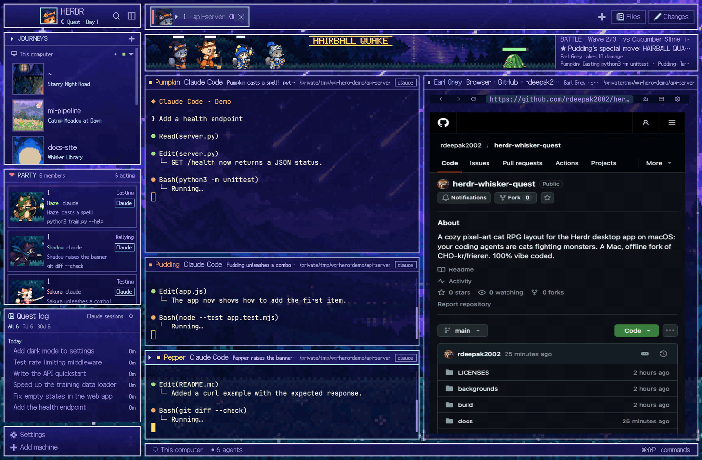
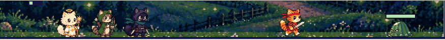
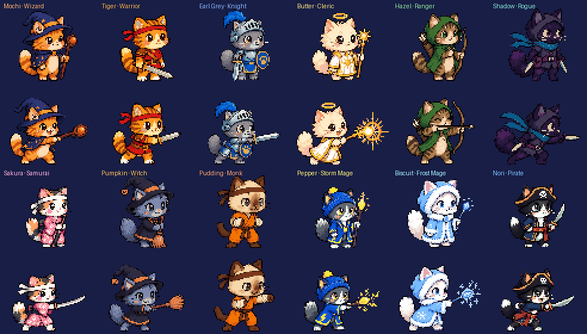
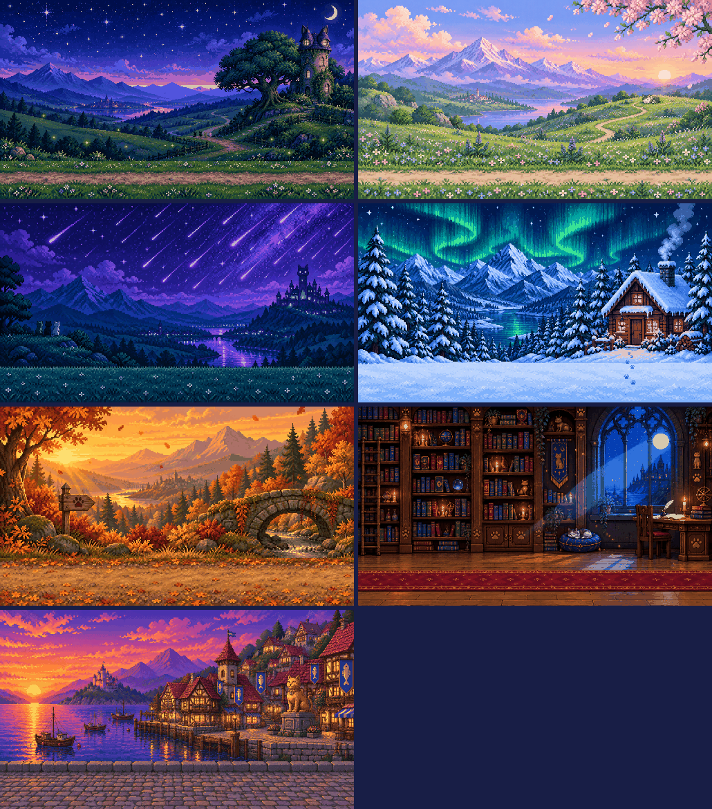
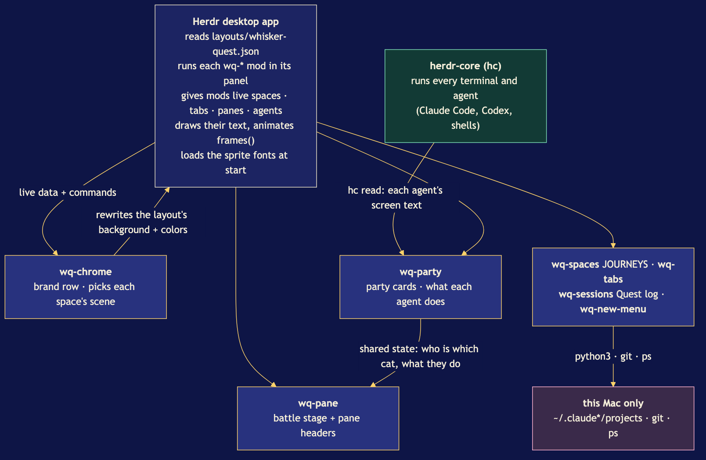
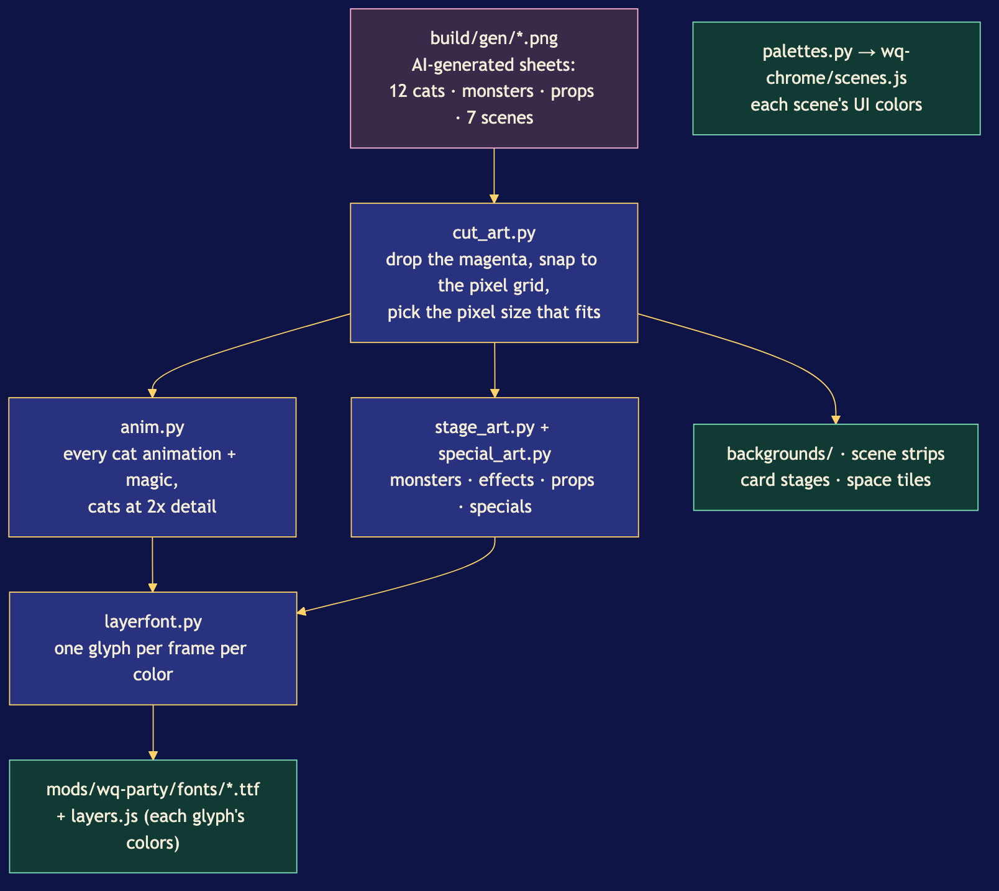
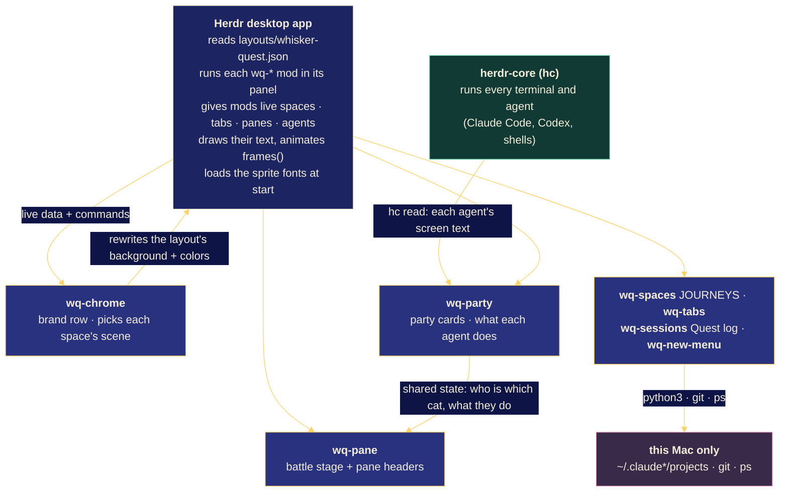
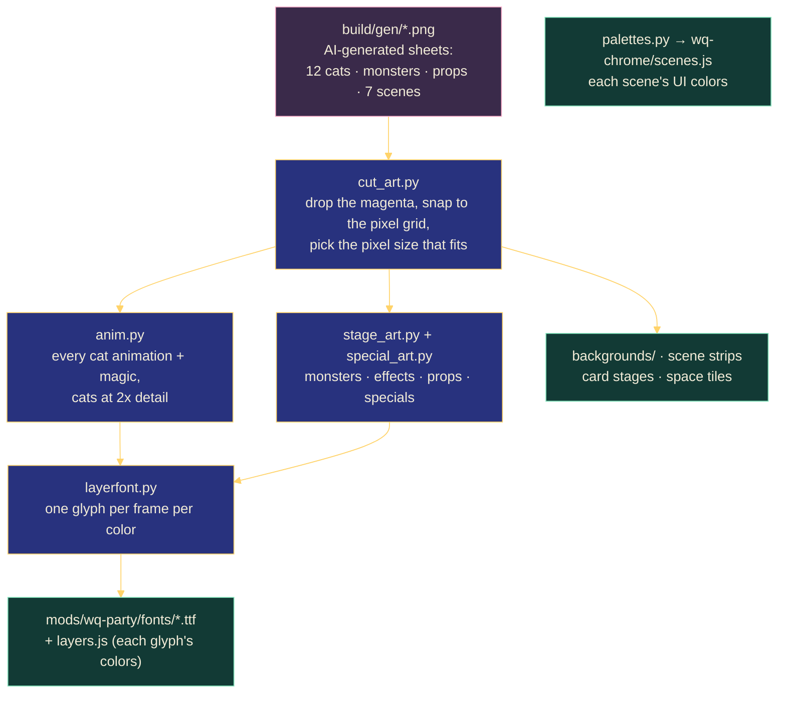

# Whisker Quest 🐾

> **AI agents:** to install this, follow [INSTALL.md](INSTALL.md) step by step.

A cozy pixel-art RPG layout for the [Herdr](https://herdr.dev) desktop app **on macOS**. Every coding agent you run
(Claude Code, Codex) becomes a little pixel cat adventurer: the wizard casts when your agent runs commands, the
knight charges when it runs tests, the cleric heals the party, and the whole party fights cucumber slimes, box
mimics and the dreaded **Vacuum Golem** on a battle stage above your terminals. Each Herdr space has its own scene,
so switching spaces takes you somewhere new.



[See the web-app demo space and its Quest log](docs/demo-web.png).



**Twelve cats**, each with its own weapon, magic and special move:



**Eight monsters**, one per scene, and the boss:


**Seven scenes**; the background, the colors of the whole window, the battle stage and its monster follow the
space you're in:



> [!WARNING]
> **This project is 100% vibe coded.** Every line of code, every build script and every doc here was written by an
> AI coding agent (Claude Code), and the art was made with an AI image model. It was tested by running it in Herdr,
> not by careful human review. Use it for fun, read the code before you trust it, and expect rough edges.

> [!NOTE]
> **Whisker Quest is a fork of [CHO-kr/frieren](https://github.com/CHO-kr/frieren)**, the wonderful Frieren
> layouts for Herdr. The idea, the layout, the mods and the battle choreography are theirs; Whisker Quest ports the
> Frieren Pixel layout to macOS, makes it run fully offline, and swaps the Frieren cast for cats. All credit for the
> original goes to its author. See [NOTICE](NOTICE).

## What you get

- **A party member per agent.** Every Claude Code / Codex agent (and agents typed by hand into a shell) is a cat.
  Its card in the sidebar shows its face, tab, model and what it is doing right now, read from its screen every
  1.5 seconds: `Tiger strikes!  npm test`, `Mochi reads the grimoire`, `Butter calls for help! Needs your answer`.
- **The battle stage** above the terminals shows the shown tab's party (up to four cats, one per pane) in one
  scene. While an agent works they fight a long battle in three waves (the scene's monster, another one, then the
  Vacuum Golem as the boss), and each cat's turns follow the kinds of work its agent did lately: tests become a
  combo, builds forge a blade at an anvil, `git` raises a banner, installs drink a potion, deletes call a meteor
  storm, searches follow footprints, the web makes it fly. Full SP gauges trigger a special move with a banner:
  COSMIC MEOW, TIGER CLAW, SKY POUNCE, HOLY PURR, ARROW RAIN, NINE LIVES, PETAL FLASH, CATNIP STORM, HAIRBALL QUAKE,
  THUNDERPAW, ICE WHISKERS, FISH TIDE. When nobody works the party camps: meals by the cooking pot, training,
  studying, fishing, naps (and a watch under shooting stars at night). Done agents open a treasure chest.
- **A scene per space.** Each space gets its own of the seven scenes (different ones for your first seven spaces),
  and the whole window follows it: the wallpaper, every panel's colors, the battle stage, its monster and the cards'
  little stages. Click **Quest · Day N** in the top-left corner to give the current space the next scene (it is
  remembered), or pin one by name in `mods/wq-spaces/places.json`: `{ "my-project": "snow-north" }`.
- **Quest log**: your Claude Code sessions on this computer and connected SSH machines (every login: `claude`, `claude2`, …), grouped by day.
  Click one to continue it in a new tab in its folder, or to jump to the tab already running it. Right-click to copy
  its `claude --resume` command.
- **Pixel everything**: tabs as inventory slots with each cat's face, spaces (JOURNEYS) as scene tiles with their git state,
  pixel pane headers with a battle line, a pixel font (Galmuri), a foldable sidebar rail.
- **Fully local.** No network calls, no telemetry of its own, no accounts. It reads only local files and asks
  `hc`, `git` and `ps` about your own terminals. Safe for a work laptop (read [Privacy](#privacy-and-safety)).

## Requirements

| What | Why |
|---|---|
| macOS on Apple Silicon | Herdr's macOS app needs it; Whisker Quest is built and tested on macOS |
| [Herdr](https://herdr.dev) desktop app, with `herdr-app` and `hc` on your PATH | the app itself (it installs both into `~/.local/bin`) |
| `python3` (3.9+) | the Quest log and the account lookup (standard library only) |
| `git` | the git summary on each space tile |
| Claude Code and/or Codex | optional: the agents your cats represent |

Rebuilding the art (not needed to use it) also needs `pip install pillow numpy scipy fonttools`.

## Install

### By hand

```sh
git clone https://github.com/rdeepak2002/herdr-whisker-quest ~/herdr-whisker-quest
cd ~/herdr-whisker-quest
./install.sh
```

Then **quit Herdr and open it again once**: Herdr loads a layout's sprite fonts only when it starts. Switch layouts
any time with `Ctrl+Shift+L` or **Settings → Look → Layout**. `./install.sh --update` replaces an earlier install,
`./install.sh --remove` takes it all out.

### Ask your AI agent to install it (works on a work laptop)

Give your agent this repository's link and say: **"Install this by following INSTALL.md exactly."**
[INSTALL.md](INSTALL.md) is written for agents: prerequisites, install, restart, and how to check each step.
Or paste this prompt into Claude Code, Codex or any coding agent on the Mac where Herdr is installed:

```text
Install the Whisker Quest layout for the Herdr desktop app from https://github.com/rdeepak2002/herdr-whisker-quest. Follow these steps exactly:

1. Check the prerequisites, and stop and tell me if one is missing:
   - macOS: `uname -s` prints Darwin.
   - Herdr is installed and has been started at least once: the folder ~/.config/herdr-app exists,
     and `herdr-app --version` and `hc --version` both work.
   - `python3 --version` prints 3.9 or newer, and `git --version` works.
2. Clone the repository into a new folder: `git clone https://github.com/rdeepak2002/herdr-whisker-quest ~/herdr-whisker-quest`.
   If that folder exists, `cd` into it and `git pull` instead.
3. Read README.md (the "Privacy and safety" section) and tell me in one line what the mods run and read.
4. From the repository folder, run `./install.sh`.
   - If it says "Already there", run `./install.sh --update` (it replaces only Whisker Quest's own files:
     the mods named wq-*, layouts/whisker-quest.json, themes/whisker-quest.json, backgrounds/whisker-quest-*).
   - It must not print "check failed". If it does, show me the output and stop.
5. Run `herdr-app status` and confirm "layout" is "whisker-quest" and "errors" is empty.
   If the layout is not active, run `herdr-app do layout.switch --name whisker-quest`.
6. Tell me to quit Herdr (Cmd+Q) and open it again once, so it loads the sprite fonts.
   Do not quit Herdr yourself if you are running inside a Herdr terminal.
7. After I reopen it, run `herdr-app shot ~/whisker-quest-check.png` and look at the picture: the sidebar's
   top-left shows a cat face and "Quest · Day 1", and the stage above the terminals shows a cat in a scene.
   If you see "?" boxes instead of cats, Herdr was not restarted: ask me to restart it again.
Do not install anything else, do not change my keys.json or other layouts, and do not use the network
beyond the git clone.
```

### Files it installs

Into `~/.config/herdr-app` (or `$HERDR_APP_HOME`): `layouts/whisker-quest.json` (+ its preview), `themes/whisker-quest.json`,
`backgrounds/whisker-quest-*.png` (7 scenes) and seven mods: `wq-chrome`, `wq-spaces`, `wq-party`, `wq-tabs`,
`wq-pane`, `wq-new-menu`, `wq-sessions`. It never overwrites a file it didn't install, and leaves your own layouts,
mods and `keys.json` alone.

## Quick start

| Do this | What happens |
|---|---|
| Start Claude Code or Codex in a tab | a cat joins the party; its card and the stage show what it does |
| Split a tab into panes with agents | up to four cats fight together on the stage (with more panes: the focused one, then agents at work, then other agents) |
| Rename a tab to `Mochi`, `Tiger`, `Earl Grey`, … | that tab's agent becomes that cat |
| Switch spaces | the scene (and the window's colors) changes with the space |
| Click **Quest · Day N** (top left) | this space gets the next scene (hover it to see the scene's name) |
| Click a party card | focus that agent's terminal |
| Click a session in the **Quest log** | continue it in a new tab (or jump to the tab running it); right-click copies the resume command |
| `Ctrl+Shift+L` | cycle layouts (back to your own and here again) |
| `Ctrl+Shift+B` | hide the sidebar; the button in the top-left corner folds it into a rail |

**Pick who plays whom**: name a tab after a cat, or map tab names in `mods/wq-party/jobs.json`:
`{ "api": "earl", "docs": "mochi" }`. Cat ids: `mochi`, `tiger`, `earl`, `butter`, `hazel`, `shadow`, `sakura`,
`pumpkin`, `pudding`, `pepper`, `biscuit`, `nori`.

**Pin a scene to a space** in `mods/wq-spaces/places.json` by the space's name: `night`, `dawn-flowers`,
`meteor-night`, `snow-north`, `autumn-road`, `mage-library`, `lakeside-town`.

**More than one Claude login**: run each with its own config folder (`CLAUDE_CONFIG_DIR=~/.claude-2`, typically a
`claude2` wrapper script in `~/.local/bin`); the Quest log lists `~/.claude-N` logins and the pane headers name the
account.

## How it works

### How it hooks into Herdr

Herdr is built to be reshaped by files: everything you see is a **layout** (a JSON file that splits the window
into panels) whose panels are filled by **mods** (small JavaScript programs Herdr runs and draws natively with its
GPU UI, GPUI). Whisker Quest is one layout and seven mods; it adds nothing to Herdr itself and changes none of its
own files. Here is what talks to what while it runs:



1. **The layout** (`layouts/whisker-quest.json`) puts each mod in its panel: `wq-chrome` in the top-left brand row,
   `wq-spaces`, `wq-party` and `wq-sessions` down the sidebar, `wq-tabs` in the top bar, `wq-pane` twice (the battle
   stage, and the header on every pane), and Herdr's own status bar.
2. **Herdr runs the mods** and hands them live data (your spaces, tabs, panes and agents with their status:
   working, waiting, done, idle) and commands (`pane.focus`, `tab.new`, `space.select`, ...). Whenever that data
   changes, each mod's `render()` describes its panel again, and Herdr draws it.
3. **herdr-core (`hc`)** runs every terminal and agent. `wq-party` reads what each agent's screen shows with
   `hc read` (every 1.5 s while it works) and recognizes the tool it's running (`Read(...)`, `Bash(npm test)`, a
   permission prompt, ...). That becomes the cat's action: casting, reading the grimoire, a test combo, a forge.
4. **The mods share state** through Herdr's shared store: `wq.who` (which cat each terminal is), `wq.activity` (what
   each agent is doing), `wq.party` (cat picks that stick), `wq.scene.pick` (a space's chosen scene). `wq-pane`
   reads them to choreograph the battle (`plan.js`: waves, turns per kind of work, specials, camp pastimes).
5. **The scene follows the space.** Herdr has no command to change a layout's wallpaper, so when you switch spaces
   `wq-chrome` rewrites the background picture and colors in `layouts/whisker-quest.json` and Herdr applies the edit
   at once. The stage and cards work out the same scene themselves (`spacescene.js`), so they switch instantly.
6. **The sprites are fonts.** Mods can't draw pixels, only text, images and boxes, so every animation frame is a
   glyph in a font (`mods/wq-party/fonts/*.ttf`, loaded by Herdr at start) and `.frames([...], ms)` flips through
   them on Herdr's animation clock, with no JavaScript running per frame.
7. **Colors on macOS.** On macOS, Herdr draws every font in one color, so each sprite is one glyph *per color*,
   stacked as text elements in their own colors and kept in sync by the shared clock (`build/layerfont.py`,
   `layers.js`). To keep that within Herdr's render budget, `wq-pane/stagelayers.js` builds the stage's elements
   ahead of time: boxes of one font share an element, spacer glyphs place sprites side by side, and each text line
   is one art pixel tall, so a sprite's height on the stage is just which line it's on.
8. **Machine-local lookups.** `wq-sessions` runs its Python reader on this computer and each connected SSH machine
   to list Claude Code sessions from `~/.claude*/projects`. `wq-pane` runs `ps` on the terminal’s machine to identify
   the account of an agent you started by hand.

### How the art is built (offline, once)

The repository ships the built files, so you never need to run this. To change the art:
`python3 build/build_all.py` (needs `pillow numpy scipy fonttools`).



- `build/gen/` holds the AI-generated sheets ([build/ART.md](build/ART.md) has the prompts).
- `cut_art.py` removes the magenta background and snaps every sprite to its pixel grid, choosing the pixel size so
  each sheet fits (cats at 62 rows, drawn at twice the stage's art resolution so faces keep their detail).
- `anim.py` composes every cat animation and its magic; `stage_art.py` and `special_art.py` add the monsters,
  effects, props, specials and the stage strips cut from each scene.
- `layerfont.py` turns all of it into fonts, one glyph per frame per color, plus `layers.js` (which colors each glyph
  uses) for the mods.

<details>
<summary>Mermaid source of both diagrams (docs/diagrams/)</summary>





</details>

## Customize

- **Scenes**: their palettes are in `build/palettes.py` (→ `mods/wq-chrome/scenes.js`), the stage strip rows and the
  monster of each scene in `build/stage_art.py` (`SCENES`, `MONSTERS`).
- **The battle**: turns, waves, specials, pastimes and victories are in `mods/wq-pane/plan.js`; which kind of work a
  screen line is (`RULES`, `COMMANDS`) in `classify` of `mods/wq-party/lib.js` (three copies: wq-party, wq-tabs,
  wq-pane).
- **Terminal see-through**: `terminal_opacity` in `layouts/whisker-quest.json` (`0.55`; `1` is solid).
- **New art**: replace a sheet in `build/gen/` (same layout: 4 × 2 poses on magenta), run
  `python3 build/build_all.py`, raise `FONT_VERSION` in `build/anim.py` and in each `lib.js` (Herdr keeps a loaded
  font family in memory), then `./install.sh --update` and restart Herdr.

## Battery

The stage redraws the window on every animation frame, so Whisker Quest is careful about when it animates:
- every animation's frame time is a multiple of the stage's 90 ms step, so all of them change on the same ticks
  (one redraw per tick instead of one per animation);
- while no agent works, the camp animates for a minute and then holds still (no redraws) until a battle starts or the
  pointer is on the stage;
- screens of idle agents are read every ~6 s instead of every 1.5 s.

Measured on an M-series Mac with Herdr's own CPU use: about 3 % at rest, about 20 % while four agents fight
(Herdr's default layout: about 1 %).

## Privacy and safety

Mods are trusted code that runs on your machine. Whisker Quest's:

- **run programs**: `python3` (its own `list.py` and `who.py`), `hc` (`hc read` on each agent's terminal to see what
  it's doing, `hc get` / `hc ls`), `git status` / `git rev-parse` in each space's folder, `ps` (your own processes,
  to name the account of an agent typed by hand), `pbcopy` (when you right-click a session).
- **read files outside their folder**: Claude Code transcripts in `~/.claude/projects` and `~/.claude-N/projects`
  (only the session's title, first prompt, folder and branch are kept), and the layout file they paint.
- **write**: the shown layout's file (background and colors, when the scene changes) and a cache at
  `~/.cache/whisker-quest/sessions.json`.
- **never use the network**: no `fetch`, no API calls, no telemetry, no Remote Control. Nothing leaves your machine.

## What's different from the original

Ported: the Pixel layout, its party, stage, tabs, spaces, pane headers and + menu. Replaced: the session lists
(the Quest log), the Windows account lookup (`ps`). Not included, because they're Windows-only or use the network:
the usage gauges (they called Anthropic's and OpenAI's APIs; HP/MP bars now show only if some other mod shares
`usage.accounts`), the Codex and Claude-desktop session lists, the results panel, smart paste and the Frieren
Journey layout.

## Known limits

- Herdr loads a layout's fonts only at start: restart Herdr after installing or rebuilding.
- The motions come from reading each agent's screen, so a tool the screen doesn't show reads as thinking.
- With more than seven spaces, scenes repeat.
- The stage shows at most four cats per tab; the party list shows every agent.
- macOS only (the original is for Windows).

## Uninstall

`./install.sh --remove` (switches back to Herdr's own layout and deletes only Whisker Quest's files).

## Credits

- **[CHO-kr/frieren](https://github.com/CHO-kr/frieren)**, the original Frieren layouts for Herdr this is forked from,
  and in turn [herdr-traveler](https://github.com/franky5440-afk/herdr-traveler) (Apache 2.0) and Herdr's built-in
  mods (Apache 2.0). See [NOTICE](NOTICE) and `LICENSES/`.
- **[Galmuri](https://github.com/quiple/galmuri)** pixel font by Lee Minseo (quiple), SIL Open Font License 1.1.
- **Art**: generated for this project with an AI image model (OpenAI gpt-image through Figma AI), then pixel-snapped
  and cleaned by code; prompts in [build/ART.md](build/ART.md).
- **Code**: written by Claude Code (see the warning above).
