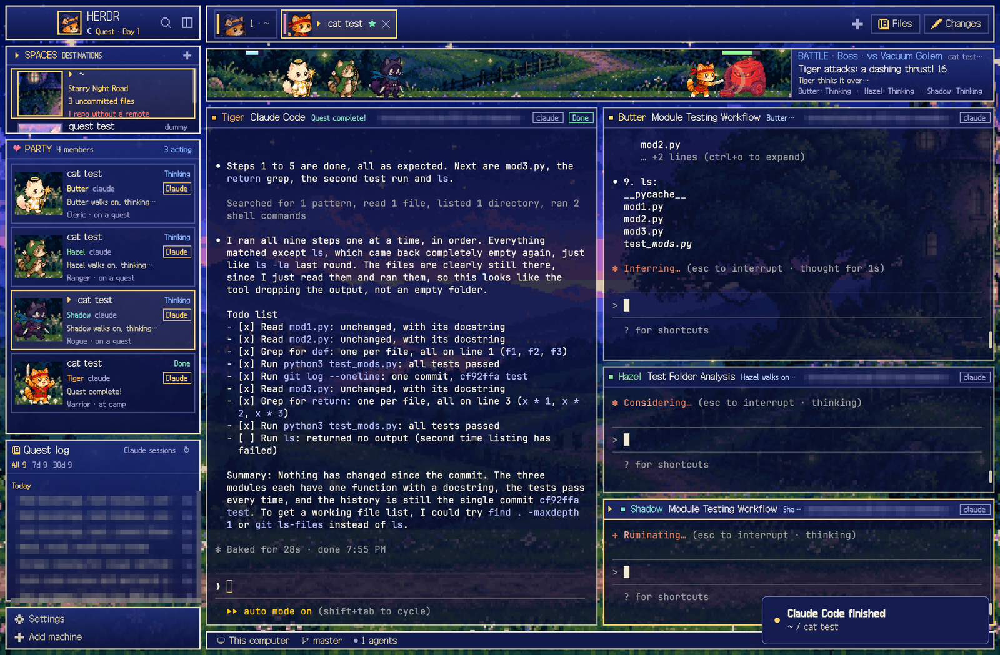

# Whisker Quest

A cozy pixel-art RPG layout for Herdr on macOS: every coding agent is a pixel cat, the shown tab's agents fight
monsters on a battle stage above the terminals while they work and camp when they rest, and each space has its own
scene that recolors the whole window. A cat-themed, offline macOS fork of CHO-kr/frieren's Frieren Pixel layout.

## What you see

Left, a 292 px sidebar of square-framed panels (2 px frame `#efe6c8`-like, gradient panel backgrounds, both following
the scene): the brand row (52 px: Mochi's face, HERDR, `Quest · Day N` and a sun/moon), the spaces as scene tiles,
the party (one card per agent: a 64 px stage with its animated cat, tab name, status, cat, account and model, and
what it's doing), the Quest log (Claude Code sessions by day), and Settings / Add machine. Right: the tabs (56 px,
inventory slots with each cat's face), the battle stage (80 px: a strip of the scene at 2× with the party and the
monster, and a 3-line battle log), the tab's panes (30 px pixel headers: cat, battle line, folder, account) and the
status bar. The scene's picture shows through the terminals at 55 %.

## How it behaves

- working: the cat acts out the tool its agent runs (read from `hc read` every 1.5 s); the stage fights a three-wave
  battle (the scene's monster, another, then the Vacuum Golem) with turns per kind of work and special moves;
- blocked: `!` bubble and `HELP!`; done: a treasure chest and victory; idle: camp pastimes (meals, training, study,
  fishing, naps; sleeping and stargazing at night).
- Switching spaces switches the scene; clicking the quest day gives the space the next scene.
- Clicking a card focuses its agent; clicking a session continues it in a new tab.

## Built from

`layouts/whisker-quest.json` (a row: sidebar column + work column; `titlebar: none`, `traffic_lights`), mods
`wq-chrome` (brand row + footer; paints the scene into the layout file), `wq-spaces`, `wq-party`, `wq-sessions`,
`wq-tabs`, `wq-pane` (`stage: true` for the stage block, else the pane header), `wq-new-menu`, and Herdr's
`workspace-status`, `files` and `changes`. Commands: `pane.focus`, `agent.focus`, `tab.new`, `space.select`,
`layout.resize`, `layout.hide/show`. Programs: `hc`, `git`, `python3`, `ps`, `pbcopy`. Art: `build/` (see README).

## Watch out

- macOS draws COLR fonts in one color: sprites are one glyph per color, stacked (see README, "How it works").
- Fonts load only when Herdr starts; a font without ASCII glyphs is skipped.
- Long renders are cut off: the stage's elements are built on a timer (`stagelayers.js`), one text line per art row.

## Done when

- `herdr-app check` passes for every wq-* mod and `herdr-app status` shows no errors.
- After a restart, cats (not `?` boxes) show in the brand row, the tabs, the cards and the stage.
- Four agents working in one tab fight together on the stage with no "could not be re-rendered" message.
- Two spaces show two different scenes.
